# Hi there, I'm Xieansecn 🛠️

`System Tinkerer` • `Android Developer` • `Linux Explorer`

  
  
  

> *"From low-level system mechanisms to modern Android applications."*

---

### 📌 About Me

- 📱 **Application Dev**：专注 Android 生态，主要使用 Kotlin / Java 构建现代应用（Jetpack Compose、Material 3）。
- ⚙️ **System & Low-Level**：深度 Linux 用户（Debian / Arch），探索 C 语言系统级编程与 POSIX 环境。
- 🐍 **Scripting & Tools**：熟练使用 Python 编写自动化脚本、数据处理与轻量工具。
- 📦 **DevOps & Self-Host**：偏好 Git CLI 原生工作流，基于 Podman / Docker 搭建私有服务（Gitea 等）。

---

### 📚 折腾记录 · Guides

踩坑与配置笔记，随缘更新：

| 主题 | 内容 |
| --- | --- |
| 🖥️ [KDE Wayland 独显与硬件加速](KDE%20Wayland%20独显与硬件加速/让KDE%20Wayland使用NVIDIA独显并启用Edge硬件加速.md) | 强制 KWin 使用 NVIDIA 独显，开启 Edge Wayland 原生模式与 VA-API 硬解 |
| ⌨️ [Fcitx5 拼音词库](Fcitx5拼音词库/Fcitx5拼音词库配置教程.md) | 维基、网络用语等超大拼音词库的安装与配置 |
| 📐 [AutoCAD 2026 安装 '4000' 报错](AutoCAD安装/解决AutoCAD%202026安装过程中的'4000'报错.md) | 清理 Autodesk 残留与死锁注册表项 |
| 🧩 [SolidWorks 2026 安装报错](SolidWorks2026安装/解决AutoCAD%202026安装过程中的各种安装报错.md) | 解决 1625 / 0x80070659 策略拦截与许可失效 |

---

### 🧰 Tech Stack & Tools

**Languages & Frameworks**

`Kotlin` `Java` `Jetpack Compose` `C` `Python` `Bash`

**Platforms & Environments**

`Android` `Linux (Debian / Arch)` `Termux` `Docker / Podman` `Git`

---

### 📊 GitHub Activity

  
   
  

---

### 📬 Connect

- **GitHub**：[github.com/Xieansecn](https://github.com/Xieansecn)
- **Email**：`xieansecn@163.com`

~~But, I'm So Lazy in Github 😭~~

